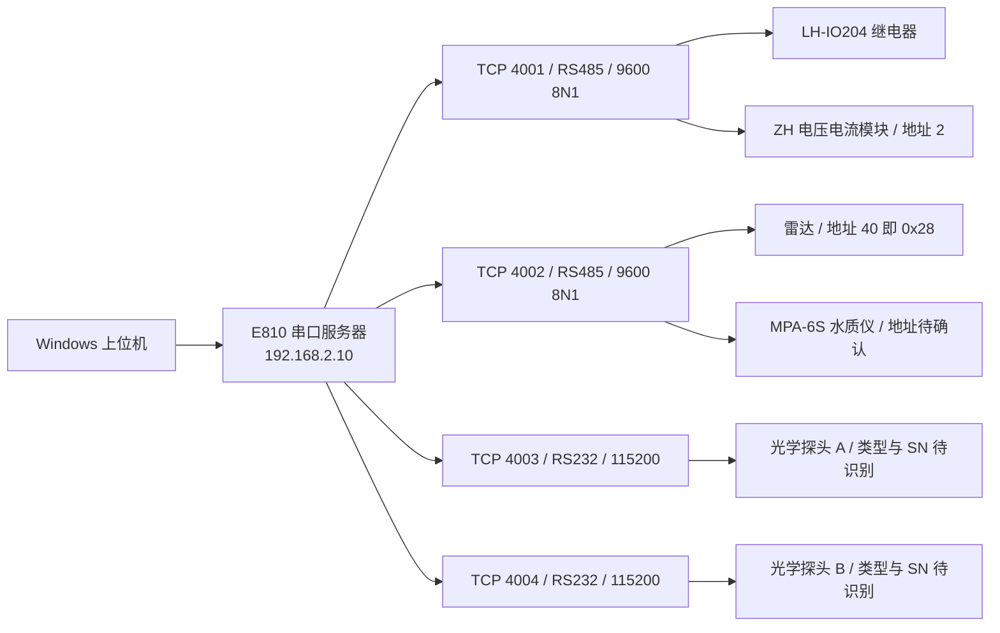
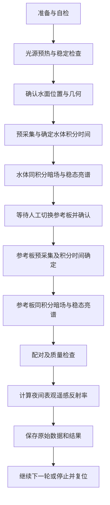

# 夜间水体测量系统上位机开发方案

编制日期：2026-09-18。阶段：资料核对与开发设计，未进行现场通信或硬件操作。

本方案用于把现有网络调试助手、虚拟串口和厂家软件中的采集操作，整合为一个 Windows 可视化上位机。首版完成设备供电、通信调度、数据解析、曲线显示和原始数据存储；随后加入水体、参考板、暗场配对采集及夜间表观遥感反射率计算。

目前继电器、电量模块和 OCR 光谱探头已有较明确的协议依据，可以开始离线开发。雷达的数据类型及单位、水质仪寄存器、现场光学探头身份仍需补齐。不能把“TCP 能连接”当作“设备数据已经正确解析”。

## 1 资料依据与适用边界

| 编号 | 资料 | 本次用途 |
| --- | --- | --- |
| S1 | 杆式夜间水体遥感反射率测量系统-立项报告-0826-v5.docx | 项目目标、配对流程、计算及质控要求 |
| S2 | 现场设备系统联调与操作配置说明书_V1.0.docx，2026-09-15 | 当前 IP、端口、供电关系及已记录的现场指令 |
| S3 | E810-DTU(4RS1E)_Usermanual_CN_v2.0 (1).pdf | 串口服务器功能与传输模式 |
| S4 | 【说明书】 LH-IO204-RS485RS232串口继电器使用说明书 .pdf | 线圈地址、开关及状态查询、FE 地址行为 |
| S5 | ZH44023D 2路全隔离高精度直流集器说明书V2606(1)(1)(1).pdf | 寄存器、量程系数、整数及浮点换算 |
| S6 | 多参数软件.A1.5.2(2)/多参数软件/MWQA使用手册.pdf | MPA 水质仪能力和厂家软件操作；未发现寄存器表 |
| S7 | 标定上位机V3/标定上位机V3/doc/sensor/OCR协议.md、OCR协议-上位机专用.md | OCR 命令、二进制帧和校验方式 |
| S8 | 同目录 ocr_probe_workflow.md、config/ocr/ocr_controller_config.json | 采集超时、锁与命令配置 |
| S9 | 同目录 doc/数据库DB文件格式说明.md、data/2026-09-08.db 至 2026-09-11.db | 存储兼容性及历史记录结构 |
| S10 | 用户提供的五张现场照片及本次端口分组确认 | 样机组成、模块铭牌和端口分组 |

S1 位于用户指定的 WXWork/Cache/File/2026-08 目录；S2～S9 位于桌面“夜间水质资料/夜间水质资料”目录。原文件未修改。文档中的历史改址、恢复出厂及配置写入命令不属于本次执行指令。

证据优先级：本次用户明确确认的事实优先；运行配置以现场验证为准，字段格式以对应型号和固件手册为准。立项选型、现场记录、软件历史配置有冲突时记录差异，不自动择一写死。

## 2 当前设备拓扑

用户已确认 4001、4002、4003/4004 的设备分组。S2 在总框图、端口表和 6.1 节中对两路光学探头的亮度/照度标注存在矛盾，因此配置页必须允许绑定端口、设备类型和 SN。不能只看端口编号就认定物理量。

传输方式为 TCP 透明传输：4001/4002 的 TCP 负载是带 CRC 的 Modbus RTU 原始帧，不能直接使用默认 Modbus TCP 的 MBAP 报文。4003/4004 若确认是 OCR 协议，则发送 ASCII 命令、接收 ASCII 或二进制光谱。

建议直接连接 E810 四个 TCP 端口，保留串口传输适配器用于台架调试。虚拟串口仅在需要厂家工具时使用。软件运行期间，同一 RS485 总线由一个调度器统一发包；厂家水质软件、SSCOM 等不能同时持续轮询该总线。

## 3 现有接线对自动化的限制

### 3.1 供电并不是两级串联开关

按 S2：路由器、E810 和继电器本体常供电；CH1 给电压电流采集模块供电；CH2 给水质仪、雷达、两路光学探头及搜索灯等负载供电。软件可以顺序打开 CH1、CH2，但不能据此把电路解释为“CH1 必须给 CH2 供电”。

界面应标注“电量模块电源 CH1”和“现场负载总电源 CH2”，不把 CH2 单独标成“灯开关”。CH2 关闭会同时中断多个仪器，不能拿它实现灯灭、仪器继续采集的环境背景测量。

### 3.2 暗场与灯灭背景必须分开

探头快门关闭获得的是探测器暗场；灯灭但探头仍观察水面获得的是环境背景。两者记录为不同采集类型。OCR 文档提供暗谱命令，但现场探头是否安装快门、暗谱命令是否真实驱动遮光机构，需要以型号和实测验证。

若研究流程要求自动开关灯测背景，需要增加独立灯控通道或调整供电分配，并形成新的接线配置。软件能预留接口，但现有接线不能靠软件补出独立灯控。

### 3.3 水体与参考板切换首版按人工辅助设计

S1 描述旋转灯杆，在水面与岸上灰板之间切换；现有资料未给出电动转台、到位传感器和运动控制协议。首版状态机在“切换至参考板/水面”处等待操作人员确认并记录时间、距离、角度，不能显示为已自动转动。要实现无人值守配对，需补充执行机构及到位反馈。

## 4 软件技术方案

建议使用 Python + PySide6 构建 Windows 桌面软件，光谱和趋势绘图采用独立绘图组件，数值处理与 UI 分离，SQLite 保存实验记录。该选择便于衔接已有 Python 光谱协议和科研处理逻辑；不是对现有 EXE 可以直接复用源码的承诺。

当前资料含打包软件、配置、协议文档和数据库，未在应用目录中找到可直接维护的业务 `.py` 源码。优先向原开发者取得源码和版本信息；若无法取得，则按协议重写设备适配器，兼容历史数据格式。不要通过操作旧软件按钮来实现正式采集。

主线程负责界面，通信及计算放在工作线程，通过信号传递不可变结果；禁止后台线程直接修改界面。线程退出需要停止请求、结束连接和确认落盘。Qt 的线程与信号用法参见[官方示例](https://doc.qt.io/qtforpython-6/examples/example_widgets_thread_signals.html)。

| 层次 | 模块建议 | 职责 |
| --- | --- | --- |
| 传输 | transport/tcp、serial、replay | 连接、读写字节、连接恢复；不做物理量换算 |
| 总线 | bus/session、scheduler | 每端口队列、互斥、超时、响应匹配、迟到帧隔离 |
| 驱动 | relay、zh_meter、radar、mpa、ocr | 封包、拆包、校验、解析及设备身份 |
| 流程 | power_sequence、capture_session | 上电、自检、预热、配对采集和停止流程 |
| 算法 | dark、integration、geometry、rrs、quality | 暗场、积分响应、距离几何、Rrs 和质量标志 |
| 存储 | repository、raw_log、export | 原始帧、配置快照、结果、历史查询与导出 |
| 展示 | dashboard、spectra、experiment、settings | 按钮、状态卡片、曲线和实验引导 |

设备接口建议统一为 `identify()`、`read_measurement()`、`get_status()`、`close()`；继电器增加 `set_output(channel, on)`，光谱探头增加 `capture(kind, integration_us)`。每个接口返回时间戳、设备身份、质量状态、原始帧引用和物理量单位，不返回没有上下文的数字。

## 5 通信调度与异常处理

1. 每个 TCP 端口只有一个接收缓冲区、一个会话管理器和一条发送队列。4001 内继电器与电量读取串行；4002 内雷达与水质读取串行。四个独立端口可以并行工作。
2. TCP 是字节流。一次读取可能只是半帧，也可能包含多帧，必须累计缓冲并按协议长度取帧。OCR 二进制帧不能单靠 CRLF 分割，数据内部也可能出现同样字节。
3. Modbus 响应检查设备地址、功能码、字节数和 CRC；异常响应单独识别。写线圈需要检查回显，再查询线圈状态。指令发出不能直接等同于执行成功。
4. RTU 响应没有事务号，读取响应通常不含寄存器起始地址。请求超时后暂停该端口后续请求，隔离迟到响应并重新建立干净会话；是否清除串口服务器缓存必须通过现场验证。禁止让旧响应匹配下一条同形状请求。
5. 初始建议值：电量/雷达约 1 秒轮询一次，水质约 5 秒一次；均为待联调参数，不是手册额定能力。相同端口不积压定时任务，忙时跳过本次轮询并记录。
6. Modbus 初始响应超时可设 1～2 秒；只读失败允许有限重试，例如最多 2 次，并退避。OCR 以 S8 的“3 秒基础缓冲 + 积分时间”为起点，若命令产生多亮帧/暗帧还须计入实际采集次数和快门时间。
7. 启动等待使用可取消的定时状态，不在 UI 线程 sleep。雷达按 S2 暂设 60 秒启动等待，期间显示倒计时，随后按有效响应判断就绪。
8. 断线后不自动反复断电重启。恢复通信后先查询继电器和设备状态，再让操作员选择恢复任务或新建任务。原中断配对不伪装为连续采集。
9. 停止采集优先取消队列中的普通请求、完成可结束的当前事务并落盘；负载断电另设明确动作。通信断开时，界面显示“关断未确认”，不能保证远程命令已断电。
10. 数据状态分为有效、过期、缺测、协议错误、未标定、供电关闭等。最后一个有效值可以保留，但必须显示采样时间和过期标记，不能持续当作实时值。

## 6 操作流程与采集状态机

### 6.1 一键连接和上电

读取配置 → 建立 4001 连接 → 查询继电器 → 按任务需要打开 CH1 → 核验电量模块应答和量程配置 → 打开 CH2 → 显示设备启动倒计时 → 建立/检查其余连接 → 识别光学探头 → 核验雷达、水质和数据存储 → 进入就绪状态。

CH1 上电不代表灯已开启；CH2 回显也不证明每个负载实际有电。电压、电流测的是灯支路还是总负载，需要按实物接线登记，界面在此之前使用“被测支路电压/电流”。

### 6.2 连续监测模式

适用于联调和固定朝向的时间序列采集。显示电压、电流、功率、雷达距离、已接入的水质参数和两路光谱。此模式不要求每次都测灰板，也不自动输出缺少参考条件的 Rrs。

### 6.3 配对实验模式

每次修改积分时间、目标位置或光路后，跳过可配置稳定帧；S1 的 3 帧作为实验起始值，不能和旧软件配置中的 2 帧混用而不记录。暗谱和亮谱均保留实际积分时间、序号与时间戳。

配对键使用 `session_id + cycle_id + target + integration_us`，不按“文件时间最近”无条件拼接。水质数据记录与光谱的时间差；最大匹配时间窗可配置，超过窗口标记缺测。两路光谱独立网络触发属于近同步，除非具有硬件同步证据，不称为严格同步。

目标切换等待、预热、重试、暂停、失败和取消均是明确状态。每次状态转移记录原因。关键输入缺失时允许保留原始数据，但阻止生成合格 Rrs 产品。

## 7 数据解析与科研计算

协议字段、指令和换算详见配套《02_设备通信协议与联调清单》。软件需要区分三层结果：原始字节、解析后的仪器值、经过实验校正的科学结果。

### 7.1 距离不能直接代替灯距

雷达的测距参考点、安装倾角和零点，与 LED 发光面不一定重合。先保存雷达原始距离，再用经过记录的安装几何换算水面高程和灯至目标距离。若雷达给出的本来就是液位，必须先确认设备配置和定义。

### 7.2 参考板配对计算

在积分响应已验证为线性时，可定义 `S_w(λ) = [DN_w(λ) - Dark_w(λ)] / t_w`，参考板同理；不线性时调用实测响应修正函数，不能简单除以积分时间。暗场须匹配积分时间、增益和适用温度范围，不能固定扣 1000 DN。

依据 S1，配对路线为：

`Rrs_app(λ) = ρ_panel(λ) / π × [S_w(λ) / S_panel(λ)] × C_d(λ)`

其中 `C_d = E_panel / E_water`。记录其定义及方向，避免误用倒数。这里的水体信号应按实际能力进行背景修正，并对未修正背景、镜面反射等添加质量说明。结果名称统一为“夜间表观遥感反射率”，单位 sr⁻¹。

`C_d` 来自实测光场、距离和角度标定；平方反比只作为有适用条件的工程估算。不能把前期实验的 1.44 写成固定现场参数。电流稳定也不能证明光谱输出稳定，光源稳定判断优先参考合适的光学监测量。

参考板采用证书逐波长反射率，不将 10%/25% 标签视为全谱常数。标定范围外不得外推补齐。S1 同时出现 420～700 nm 与 420～720 nm，软件应提供可配置目标波段，验收前由项目负责人统一口径；实际有效波段取信号质量与所有标定覆盖的交集。

### 7.3 双探头直接比值路线

只有在 HSL 辐亮度、HSE 辐照度的设备身份、单位、辐射定标、观测几何和背景处理均有效时，才启用 `L/E` 路线。HSE 若只测到灯附近或其他平面的辐照度，还需映射到实际水面；不能将辐照度当作 lux，也不能用 lux 直接代替光谱辐照度。

### 7.4 质量控制

逐波长记录低信号/低 SNR、饱和、无标定、分母无效等标志；逐轮记录配对超时、距离变化、光源漂移、暗场缺失、人工切换待确认、环境背景未处理、设备过期数据等标志。保存阈值、算法版本及校准文件哈希。

SNR 估计方法、稳定窗口、CV 阈值和连续有效波段最小长度须写入实验配置，并用重复测量验证。无效通道在图上断开或遮罩，导出保留质量码；不要把它们填成 0 或平滑成有效信号。

## 8 界面设计

| 页面 | 操作人员看到的内容 | 主要动作 |
| --- | --- | --- |
| 总览 | 网络连接、设备就绪、CH1/CH2 状态、被测支路电量、距离、水质、最后更新时间 | 连接系统、按序上电、开始/停止监测、停止并关闭负载 |
| 光谱 | 水体/参考板/暗场曲线、HSL/HSE 身份、积分时间、饱和比例、有效波段 | 单次采集、连续采集、切换 DN/已标定物理量 |
| 配对实验 | 当前步骤、目标位置、预热倒计时、每步数据完整性、Rrs | 新建实验、确认切换、重测本轮、计算与保存 |
| 历史数据 | 按日期/任务/设备/质量筛选的记录与曲线 | 回放、导出、查看原始帧及参数 |
| 设备设置 | IP、端口、SN 绑定、仪器地址、量程模式、轮询周期 | 保存配置、导入校准、只读诊断 |
| 通信诊断 | 时间、端口、方向、HEX/ASCII、CRC 和错误原因 | 复制帧、保存日志；高级发送须经过总线队列 |

原型布局：顶部显示任务和整体状态；左侧为设备状态；中央为光谱/趋势；右侧显示采集步骤；底部显示最近事件。日常界面不要求操作员输入十六进制。

“连接正常”“仪器就绪”“数据有效”分开显示。设备未接入或协议未确认时显示“待接入”，不要显示模拟数值充当现场数据。演示模式必须有持续可见的模拟标识。

## 9 数据保存与历史兼容

保留现有光谱数据库的探头、标定、原始数据、DN/物理量光谱和 captures 关联思路。只读检查确认四个历史 DB 包含这七类表；其中有多种 OCR、IEP、TriOS 设备，不能把这些历史 SN 自动当作本次现场探头。

建议新建独立数据库并写入 schema 版本，不原地修改厂家数据：

| 记录 | 关键字段 |
| --- | --- |
| sessions / cycles | UUID、地点、操作者、任务状态、起止时间、配置快照 |
| devices | 型号、SN、协议版本、端口、地址、安装位置 |
| raw_frames | UTC 时间、单调时钟、收发方向、连接代次、端口、请求 ID、原始 BLOB、解析状态 |
| measurements | 指标名、值、单位、质量码、采集时间、raw_frame_id |
| spectra / captures | 光谱数组、波长、目标、积分时间、暗谱关联、帧序号、标定引用 |
| geometry / references | 雷达距离、灯距、角度、板证书、Cd 模型和来源 |
| products | Rrs、有效掩码、质量码、算法版本、输入记录引用 |
| events | 电源操作、状态转移、错误、人工确认和恢复操作 |

统一存 UTC，界面显示北京时间。存储队列有上限，磁盘满、写入失败和队列溢出应停止新的正式实验并报告，不能静默丢帧。断网不影响本地存储；上传可以后续扩展。导出提供带单位和质量标志的标量/光谱 CSV，以及完整原始数据包。

## 10 分阶段开发与验收

以下是单人开发、可以及时获得协议和硬件反馈的工作量估计，不是确定交付承诺。

| 阶段 | 预计工作量 | 可验收结果 |
| --- | --- | --- |
| P0 协议冻结 | 2～4 工作日，等待厂家资料另计 | 端口/SN 表、继电器正式地址、电量模式、水质/雷达字段及成对收发样例 |
| P1 通信与电源 | 4～6 工作日 | 四端口架构、继电器回读、电压电流显示、日志、断线状态、离线回放 |
| P2 光谱与其他传感器 | 5～8 工作日 | 暗亮谱、积分时间、光谱图、已补齐协议的雷达及水质数值 |
| P3 配对流程及计算 | 5～8 工作日 | 人工切换引导、配对检查、校准输入、Rrs、质量码、历史导出 |
| P4 联调与交付 | 3～5 工作日 | 故障测试、持续运行、安装包、配置模板和操作说明 |

总开发量约 19～31 工作日。独立灯控、自动转台和新增驱动的硬件开发不计入；可先交付 P1/P2 作为日常采集工具。水质协议未拿到时，不阻塞电源、电量和光谱功能。

必须覆盖的验收：

1. 8 条现有基础 RTU 指令 CRC 与资料一致；CRC 错、异常响应、错地址、半帧、粘包、迟到帧不会生成有效读数。
2. 电量用已知输入或可靠仪表比对，覆盖 16 位、32 位两种模式和满量程；OCR 用大于 32767 的 DN 验证无符号解析，用包含 CRLF 的二进制负载验证拆包。
3. 继电器操作后读回状态；断线、供电关闭和设备启动中正确区分；点击停止后不再排入新采集。
4. 水质每个参数与厂家软件在单主站、相同条件下比对，核实单位与无效码；雷达以已知距离验证字节序、单位及几何换算。
5. 改积分时间后按配置跳帧；缺暗场、错探头、缺板反射率、配对超时不能输出“有效”Rrs。
6. 原始帧能够回放复算，导出结果能追溯至输入、校准和算法版本；模拟与真实数据始终有明确区分。
7. 先进行台架连续运行及网络中断恢复，再开展外业测试。S1 的连续 7 晚无人现场干预目标，需自动切换等硬件条件和实际任务定义具备后验证，不能由桌面程序运行一天代替。

## 11 开始编码前应收齐的最小信息

| 项目 | 需要的具体证据 | 影响 |
| --- | --- | --- |
| 继电器 | 真实单播地址、工作模式、与电量模块共线时的收发样例 | 正式上电控制 |
| 电量模块 | 30V/5A 铭牌确认、0x0053/0054 读值、实际被测支路、已知输入下的响应 | 物理量缩放及 UI 命名 |
| 雷达 | 现场铭牌；MIK-WSR201 对应协议、距离字段类型/单位/无效值；至少两个已知距离样例 | 从 4 字节变为可信距离 |
| 水质仪 | 当前地址、固件、实际安装探头、厂家寄存器表、一次完整收发 | 水质数据接入 |
| 两路光学探头 | 端口对应 SN、HSL/HSE 或其他型号、固件、完整串口格式、实际原始帧、快门能力 | 选择正确驱动及定标 |
| 现有上位机 | 如可提供，源码及依赖版本；若不可提供则确认协议版本 | 评估复用工作量 |
| 实验规则 | 稳定条件、帧数、板证书、几何/Cd 标定、目标波段口径 | Rrs 计算与验收 |

资料收齐方式优先为导出当前配置、提供厂家协议和记录人工已调通的一次收发，不要求为收集信息重复改址或重置设备。协议暂缺时驱动应保持“未配置/待验证”，保存原始帧，不猜数值。
